<p align="center">
  
</p>

<h1 align="center">MacRAR</h1>

<p align="center">
  A WinRAR-style <b>archive manager</b> for macOS: RAR, ZIP, 7Z and TAR.<br>
  Under the hood it runs RARLAB's <code>rar</code> / <code>unrar</code> tools and macOS's <code>bsdtar</code>, with a native SwiftUI interface and Finder integration on top.
</p>

<p align="center">
  <b>🇬🇧 English</b> · <a href="README.tr.md">🇹🇷 Türkçe</a>
</p>

<p align="center">
  <a href="https://gitlab.com/freeware2/macrar/-/releases/permalink/latest/downloads/MacRAR.pkg"></a>
</p>

<p align="center">
  <a href="https://gitlab.com/freeware2/macrar/-/releases">All releases</a> · <a href="#installation">Installation steps</a> · The interface is in English and Turkish
</p>

> [!warning] First time you open the installer, macOS blocks it. This is expected.
> MacRAR is free and not notarized by Apple, so when you double-click the downloaded `MacRAR-<version>.pkg` for the first time, macOS says it *could not verify* the package and does not open it. You only need to allow it once:
>
> 1. In the warning, click **Done**. Do **not** click *Move to Trash*.
> 2. Open **System Settings ▸ Privacy & Security** and scroll down to **Security**.
> 3. Next to *"MacRAR-&lt;version&gt;.pkg" was blocked to protect your Mac*, click **Open Anyway** and confirm with your password or Touch ID. The installer opens.
>
> Prefer Terminal? Run `xattr -d com.apple.quarantine ~/Downloads/MacRAR-*.pkg`, then double-click the package.

<p align="center">
  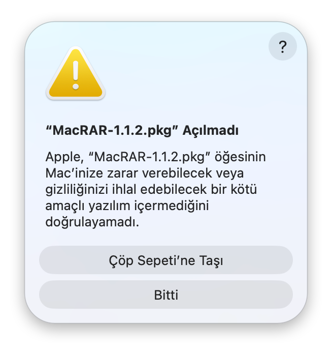
  &nbsp;
  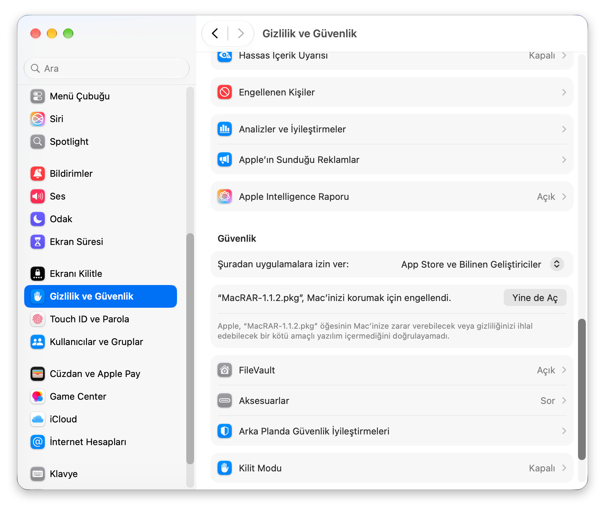
</p>
<p align="center"><sub>Left: click <b>Done</b>. Right: <b>System Settings ▸ Privacy &amp; Security ▸ Open Anyway</b>. (Screenshots from a Turkish macOS.)</sub></p>

> MacRAR is not affiliated with RARLAB or WinRAR. The installer only carries RARLAB's free **`unrar`** tool (unmodified, with its license);
> `rar` is not bundled; the Setup Assistant downloads it straight from rarlab.com when you ask it to.

Releases and release notes: [GitLab ▸ Releases](https://gitlab.com/freeware2/macrar/-/releases).

## Screenshots

### Main window

The file browser with the sample archives; the action bar has Add, Extract, Test, View, Delete, Info, Repair, Merge and Compare.

<p align="center">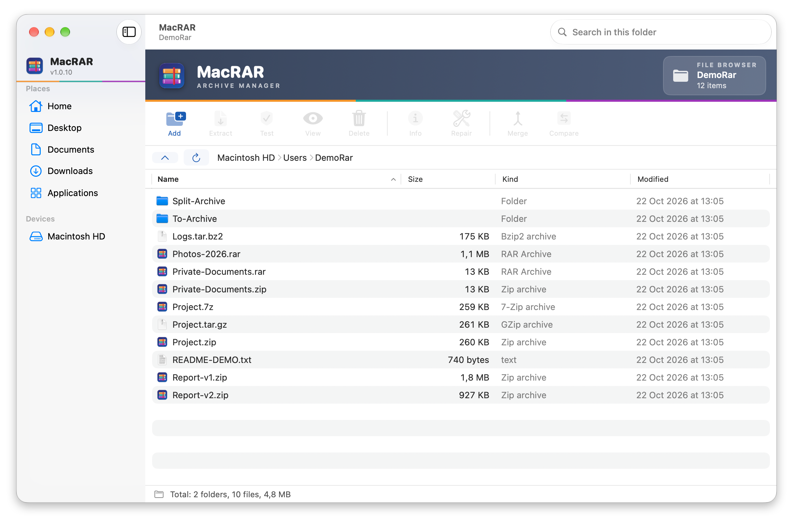</p>

### ⭐ Finder right-click menu

> **Work with archives straight from Finder, without opening MacRAR.** Right-click any file, folder or archive and the MacRAR items are right there in Finder's own menu, with the MacRAR icon:
>
> - **Archives:** Open · Extract Files… · Extract Here · Extract to a folder named after the archive
> - **Files and folders:** Add to Archive… · Compress to “name.rar” / “name.zip” · Compress to a timestamped RAR / ZIP
>
> The work runs in the background with a small progress panel, and the items follow the language chosen in MacRAR (here English, while Finder itself is Turkish).

<p align="center">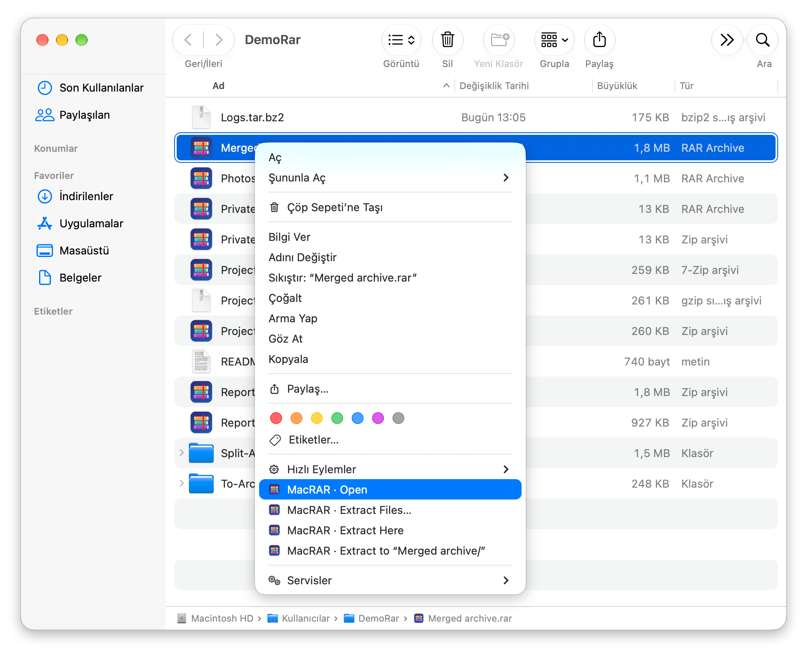</p>

### Compare archives

Two versions of a report: files that are only in one archive and files with different content (CRC) are listed.

<p align="center">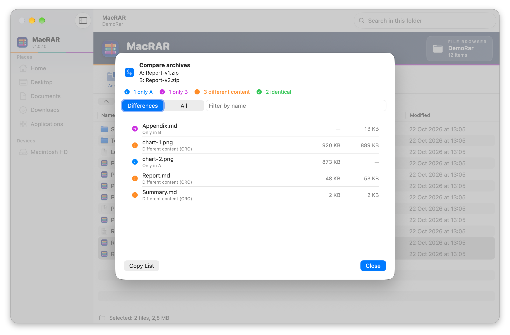</p>

### Password prompt

Asked for encrypted archives, with the saved passwords menu and the option to save the password.

<p align="center">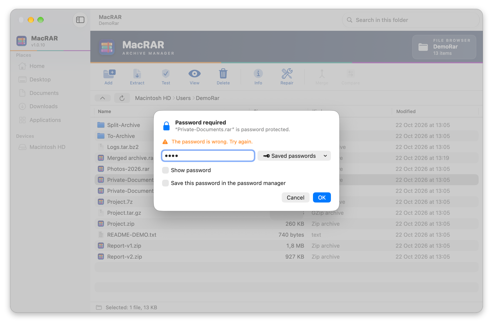</p>

### Password manager

Passwords are stored in the macOS Keychain.

<p align="center">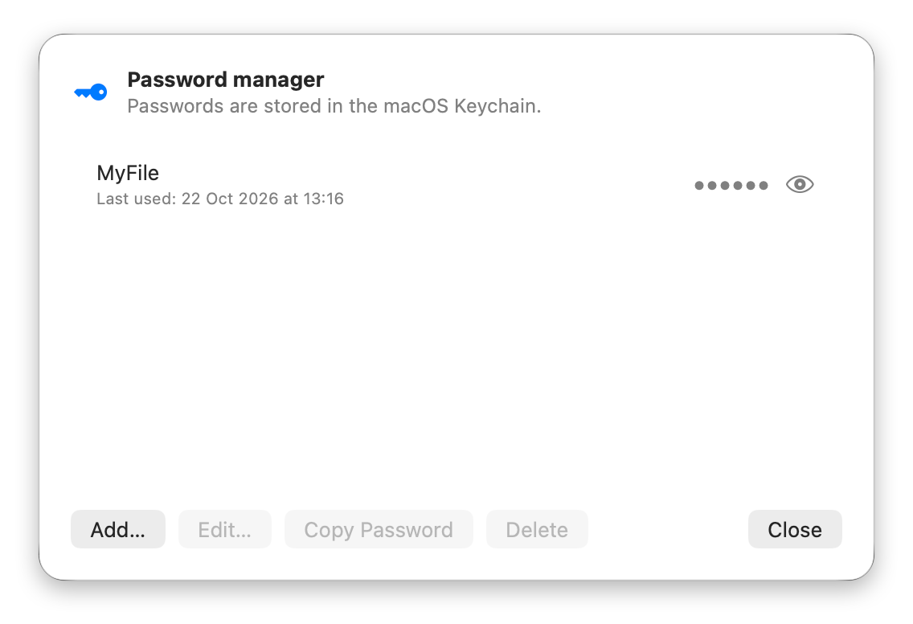</p>

### Settings ▸ General

Hidden files, interface language and the password manager.

<p align="center">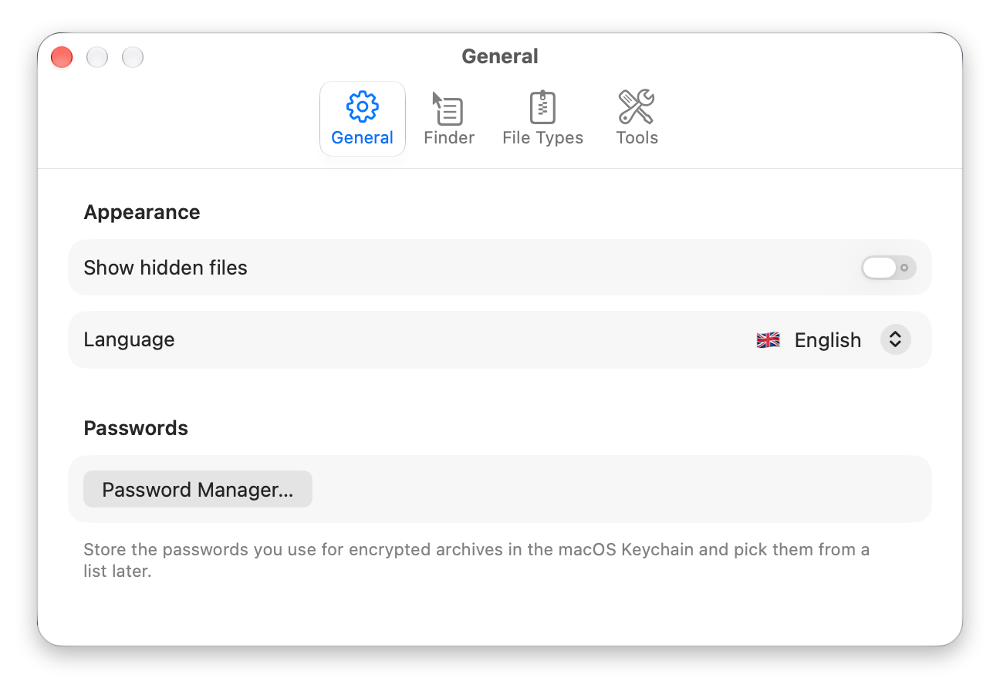</p>

### Settings ▸ Finder

Timestamp format for quick compression and the right-click menu switch.

<p align="center">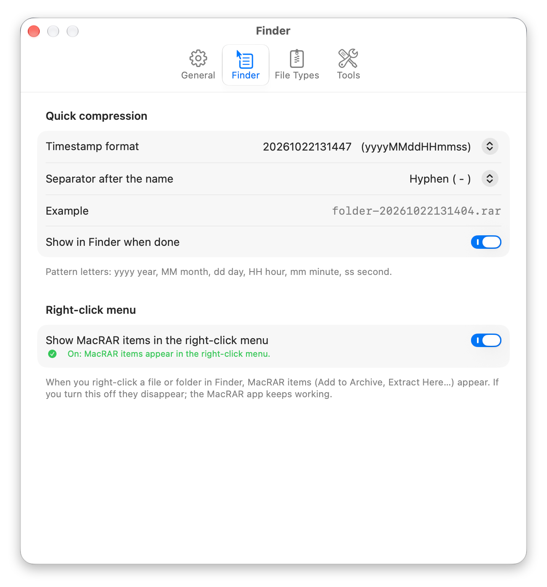</p>

### Settings ▸ File Types

The default app for RAR, 7Z, ZIP and TAR.GZ.

<p align="center">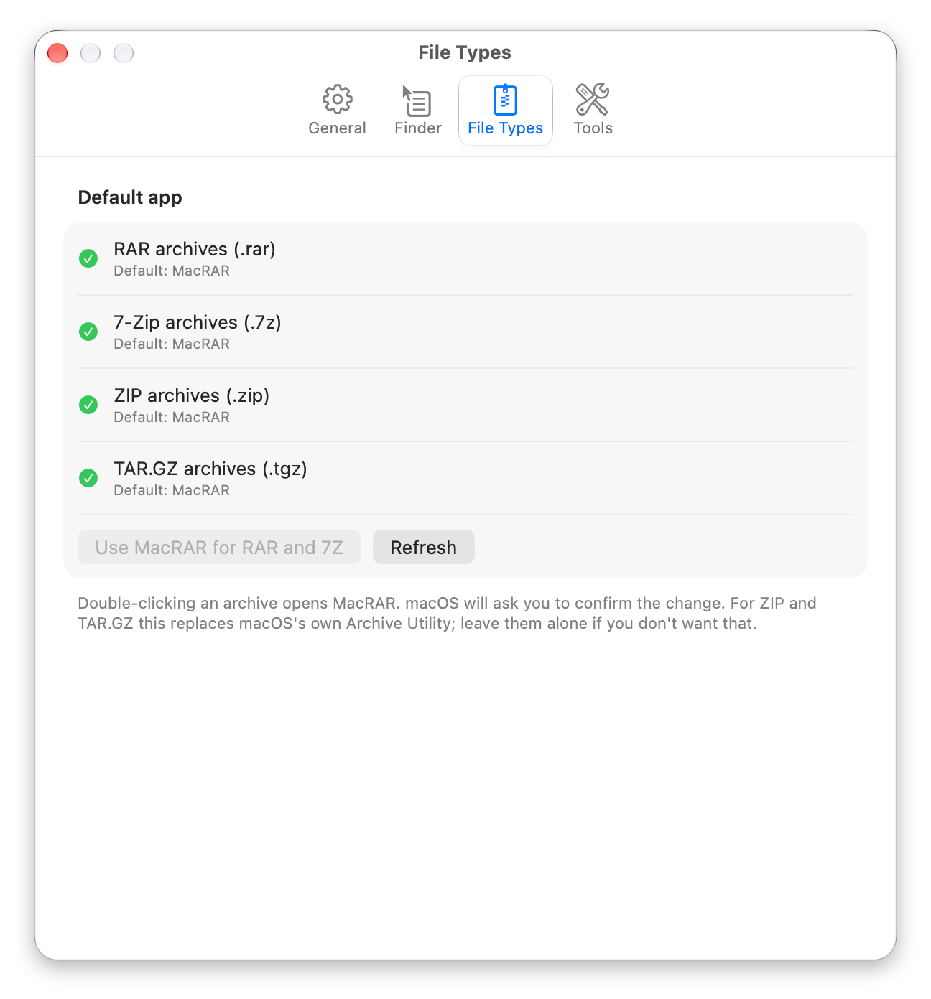</p>

### Setup Assistant

Shows the status of the RAR tools, the Finder menu and the default app, with one-click fixes.

<p align="center">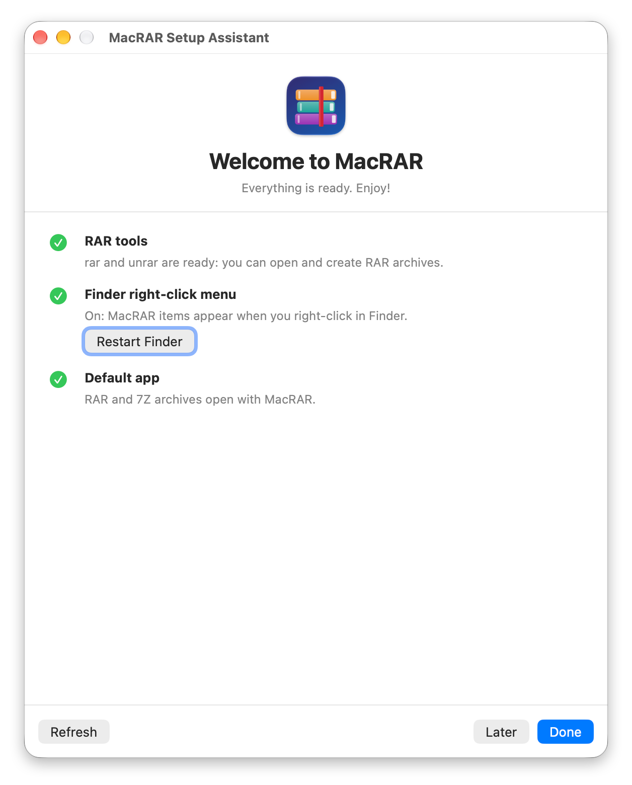</p>

## Features

- **Look inside without extracting:** browse the folder tree, sort, search inside the archive (case and diacritic insensitive),
  size / packed size / CRC32 / date columns.
- **Extract:** the whole archive or selected files/folders; overwrite / skip / rename automatically; extract without paths;
  subfolder named after the archive. Extract by **dragging** from the archive to Finder (extraction happens on drop).
- **Compress:** RAR5, RAR4, ZIP (AES-256 password), 7Z, TAR.GZ/BZ2/XZ. For RAR: method (0–5), dictionary size, solid archive,
  password + file name encryption, recovery record, splitting into volumes, locking, comment, test, delete after archiving.
  Optional **timestamp** in the name (format of your choice). The **Archive** window has General / Password / Advanced tabs
  (show password, pick a saved password). ZIP/7Z/TAR do not need `rar`.
- **Real progress:** byte-based progress bar that never goes backwards when compressing and extracting (it moves even for one large file).
- **Edit archives:** for **RAR**, add, delete, rename, comment, recovery record, lock, repair. For **ZIP**, add
  (into subfolders too; files with the same name are replaced), delete and rename; no `rar` needed, and password-protected (AES-256) ZIPs use the open archive's password.
  The ZIP is rewritten to a temporary file and moved into place atomically (the original archive is not damaged if something fails); for a large ZIP this takes time because the archive is rewritten.
  7Z/TAR are read-only.
- **Test:** for RAR, ZIP, 7Z and TAR; in folder view several archives can be selected and tested at once, with one summary.
- **Merge archives:** select 2 or more archives and collect their contents in one new archive (for files with the same path the later archive wins; you are warned first).
- **Compare archives:** compares the contents of two archives without extracting them (only in one of them, CRC/size differences). For ZIP the CRC is read from the central directory.
- **Estimated archive size in the Add window** (approximated by sampling the sources).
- **Hint/note field in the password manager.**
- **Password manager:** store the passwords you use for archives in the macOS Keychain and pick them from a list later.
- **Finder integration:** MacRAR items with an icon in the main right-click menu, depending on the selection (compress to RAR and ZIP, open, extract); operations
  run **without opening the main window**, with a small progress panel; MacRAR icon on `.rar` / `.7z` files.
- **Setup Assistant** and **Settings** (General / Finder / File Types / Tools); install `rar` from RARLAB with one click;
  **Help ▸ Uninstall MacRAR…**
- **About window** (MacRAR menu → About MacRAR): version/build, developer, short usage notes and shortcuts, tool versions and Finder extension status.
- **Test**, **Preview** (Quick Look / Space), open with a double-click, drag and drop (open an archive / archive files), context menus.
- A two-mode window like WinRAR: a file manager when no archive is open, the archive's contents once you enter one. Leave with Enclosing Folder / Backspace.
- **English and Turkish interface:** MacRAR follows the system language; change it in **Settings ▸ General ▸ Language** or right in the **Setup Assistant** on first launch (🌐 System language / 🇹🇷 Türkçe / 🇬🇧 English). The new language takes effect when MacRAR is reopened. The Finder right-click menu uses the chosen language too.

## Requirements

- macOS 15 or later
- **Opening RAR:** RARLAB's free `unrar` tool comes with the app (RARLAB license section 3.a: the UnRAR components may be distributed separately;
  the files and license texts are taken unmodified from the official package by `scripts/fetch_unrar.sh`, verified by SHA-256).
  If `unrar`/`rar` is installed on your system, that one is used.
- **Creating/editing RAR:** needs RARLAB's `rar` tool. The RARLAB license forbids distributing the trial version inside other software without written
  permission, so MacRAR does **not** bundle it. The **“Download and install rar”** button in the Setup Assistant (or in the warning bar of the main window)
  downloads the official package from `https://www.rarlab.com`, verifies it by running `rar`/`unrar` and installs it without an administrator password
  in `~/Library/Application Support/MacRAR/tools/rar`. To install it manually, download the package from
  [rarlab.com/download.htm](https://www.rarlab.com/download.htm) and copy the `rar` file into `/usr/local/bin`.
  The `rar` trial is free for up to 40 days, after which a RARLAB license is needed. *Note: the Homebrew `rar` cask was disabled on 2026-09-01 because it
  failed Gatekeeper checks; `brew install --cask rar` no longer works.*
- **Optional (`unar`):** if there is no `unrar`/`rar` at all and `unar` + `lsar` are installed, MacRAR uses them to open, list, test and extract RAR archives (read-only).
  Limits: extracting without the folder structure is not supported, a conflicting top folder is renamed (`src` → `src-1`), and the password is briefly visible
  on the `unar`/`bsdtar` command line (RAR passwords go through stdin).
  Creating ZIP/7Z/TAR works without them.
  You can change tool paths in the **Settings ▸ Tools** tab.
- To build: the Xcode command-line tools (Swift 5.9+) and an internet connection: `scripts/build_app.sh` downloads the free `unrar` from RARLAB (SHA-256 verified) into `build/cache` and puts it in the app.

## Installation

### With the installer (recommended)

Open the **`MacRAR-<version>.pkg`** file and follow the steps (you will be asked for an administrator password). The installer:

1. installs MacRAR in the `Applications` folder,
2. **turns on the Finder right-click menu extension** and restarts Finder,
3. opens MacRAR; on first launch the **Setup Assistant** shows the remaining steps (RAR tools, default app) with one-click fixes.

Nothing is left to do by hand. The package is not notarized by Apple, so **macOS blocks it the first time you open it**: click **Done** in the warning, then
**System Settings ▸ Privacy & Security ▸ "Open Anyway"** (see the warning with screenshots at the top of this page).
Installer log: `/tmp/MacRAR-kurulum.log`. To uninstall: **Help ▸ Uninstall MacRAR…** inside MacRAR (removes the app, the Finder extension and the installer receipt; offers options for settings, downloaded tools and saved passwords), or `bash uninstall.sh` in Terminal.
If you only move the app to the Trash, the settings, `~/Library/Application Support/MacRAR` and the passwords in the Keychain stay behind.

The **Setup Assistant** opens automatically on MacRAR's first launch; open it later with **Help ▸ Setup Assistant…**.
It shows the status of the RAR tools (`rar`/`unrar`), the Finder menu and the default app, and offers buttons to fix what is missing
(“Download and install from RARLAB” for `rar`).

To build the installer yourself:

```bash
scripts/build_pkg.sh     # build/MacRAR-<version>.pkg + .sha256 + KURULUM.txt + uninstall.sh + LICENSE.txt
PKG_SIGN_IDENTITY="Developer ID Installer: …" scripts/build_pkg.sh   # (optional) signed package
```

### From source (development)

```bash
git clone https://gitlab.com/freeware2/macrar.git && cd macrar
UNIVERSAL=1 INSTALL=1 scripts/build_app.sh   # installs /Applications/MacRAR.app (UNIVERSAL: arm64 + x86_64)
pluginkit -e use -i local.macrar.app.FinderSync && killall Finder   # turns on the Finder right-click menu
```

Without `INSTALL=1` the script only produces `build/MacRAR.app`. Run `killall Finder` after every reinstall
(Finder keeps the old extension connection; otherwise the right-click menu disappears).

You can also turn the extension on in the interface: System Settings → General → Login Items & Extensions → Extensions → **Finder** → MacRAR.

### Signing and Keychain access

With the default **ad-hoc signature** the code hash changes with every build, so after each update macOS asks again for Keychain access
for the password manager. To avoid this, build with a real signing identity
(see its name with `security find-identity -p codesigning`):

```bash
SIGN_IDENTITY="Apple Development: Your Name (TEAMID)" UNIVERSAL=1 INSTALL=1 scripts/build_app.sh
```

Because the identity stays the same, "Always Allow" given once keeps working in later updates.
An ad-hoc signed app may need right-click → Open for the Gatekeeper warning on first launch.

## Using it in Finder

### The main right-click menu (Finder Sync extension)

Once the extension is on, MacRAR items (with its icon) appear directly in the right-click menu and change with the selection:

- **Archive file** selected: `MacRAR · Open`, `Extract Files…`, `Extract Here`, `Extract to “archivename/”`
- **File/folder** selected: `Add to Archive…` (with all options such as a password), `Compress to “name.rar”`, `Compress to Timestamped RAR`
  and, with macOS's built-in `bsdtar`, `Compress to “name.zip”`, `Compress to Timestamped ZIP` (ZIP does not need `rar`).
  **If `rar` is not installed, the RAR compression items are hidden**; the app writes the `rar` status (and the chosen interface language) to
  `~/Library/Application Support/MacRAR/finder.state`, and the sandboxed Finder extension reads it when it builds the menu. Once `rar` is installed the menu updates on the next right-click.

Quick extraction does **not** overwrite existing files: in RAR a conflicting file is renamed automatically (`file(1).txt`),
in ZIP/7Z/TAR it is skipped. If several archives are selected, each is extracted into its own folder.

**Window behavior:** compress/extract operations started from Finder **do not open the main window**; for operations longer than half a second a small
**progress panel** with the MacRAR band is shown (closing it with X cancels the operation). The **Add to Archive…** and **Extract Files…**
windows also open without the main window, in a movable separate window (with the MacRAR band on top). The main window only opens for a password prompt,
an error or `MacRAR · Open`. There are no separate MacRAR items under Services/Quick Actions; everything is in Finder's main right-click
menu.
If **MacRAR was started by the operation**, it quits by itself when the work is done; if it was already open and you are using it, it is left alone.
`MacRAR · Open` keeps the window open.

### Timestamped names

In **Settings ▸ Finder** choose a preset format (`20261009112345`, `2026-10-09_11-23-45`, …) or a custom pattern (`yyyy-MM-dd_HH-mm-ss`) and a separator
(`-`, `_`, space, none); the settings show a live example name. The same is available in the app's Commands menu (⌥⌘Z / ⇧⌥⌘Z)
and as "Add a timestamp to the name" in the Add window.

### File associations and icon

MacRAR declares the `.rar` and `.7z` types with its own icon; Finder shows these files with the MacRAR icon.
**Default app:** the **Settings ▸ File Types** tab shows the current default app for RAR, 7Z, ZIP and TAR.GZ;
"Make MacRAR the default" (with macOS's confirmation) makes a double-click open MacRAR. The buttons are only enabled while MacRAR is installed
in the `Applications` folder. (Alternative: right-click an archive → Get Info → Open with → MacRAR → Change All.)
If the icon is stuck in the cache, run `killall Finder` (and `killall Dock` if needed).

## Settings

| Tab | Contents |
|---|---|
| **General** | Show hidden files, **Language** (System language / Türkçe / English), Password Manager |
| **Finder** | Timestamp format/separator for quick compression, “show in Finder when done” and the **right-click menu on/off** switch (Finder must restart for the change; a button is offered) |
| **File Types** | Default app for RAR, 7Z, ZIP, TAR.GZ |
| **Tools** | Paths of `rar` / `unrar` / `bsdtar` and installing `rar` |

## Password manager

When opening an encrypted archive (or in the **Password** tab of the Archive window) you can pick a password you used before from the **Saved passwords** menu,
and add a new one with **“Save this password in the password manager”**. Each entry can have an optional **hint/note** (not the password itself); the hint appears next to the name in the saved-password menus. The password is saved only after it actually opens the archive
(a wrong password is never saved; the same password is not added twice; the result is shown in a notice). Manage them with **Commands → Password Manager…**
(⇧⌘P) or Settings ▸ General: add / edit / delete / show / copy (a copied password is cleared from the clipboard after 30 s).

Passwords are stored as a single item in the macOS **Keychain**; the app only touches the Keychain when a password is needed.

## Architecture

| Part | Role |
|---|---|
| `Sources/MacRARCore` | UI-independent core: `ProcessRunner` (subprocesses, cancellation, stdin), `RarListParser` / `TarListParser` / `UnarListParser` (listing output), `ProgressParser` / `ProgressTracker` (progress), `TransferMonitor` (byte-based progress from open file offsets), `ArchiveService` (all operations), `ZipEditing` (ZIP add/delete/rename, central directory reader), `ArchiveComparison` (comparison and merge conflicts), `SizeEstimator` (estimated archive size), `RARInstaller` (download and install rar from RARLAB), `ToolPaths` / `ToolGuidance` (finding tools and guidance), `AppRemoval` (in-app uninstall), `PasswordVault` (Keychain), `ArchiveNaming` (names and timestamps), `FinderIntegration` / `FinderToken` / `FinderState` (menu contents, extension↔app commands, secret key, `rar` status and language). |
| `Sources/MacRAR` | The SwiftUI app: `AppModel` (state + operation flow), `MainView`, `FileTableView`, `AddSheet` / `OtherSheets` (Add/Extract), `CompareSheet` (archive comparison), `ProgressPanel` / `SheetPanel` (progress panel and movable dialog window for operations started from Finder), `SettingsView`, `AppLanguage` (language choice), `SetupAssistant`, `AppRemovalView`, `ArchiveDrag`. |
| `FinderExtension` | The Finder Sync extension (`MacRARFinder.appex`); compiled by `build_app.sh` and embedded in the app. Shared sources: `FinderIntegration`, `FinderToken`, `FinderState`. |
| `Resources` | Interface translations: `tr.lproj` and `en.lproj` (`Localizable.strings`, `Localizable.stringsdict` for plurals, `InfoPlist.strings`); `FinderExtension/` holds the extension's own name. The keys are the Turkish strings in the source code. |
| `scripts` | `build_app.sh` (packaging, signing, installing), `fetch_unrar.sh` (takes `unrar` from the official package, verified), `build_pkg.sh` (installer: scripts, pages in both languages and distribution file under `pkg/`), `check_strings.sh` (missing translation check), `uninstall.sh`, `Info.plist` files, icon generator. |

Because the extension is sandboxed, it does not touch files; it passes the selected paths to the app through a `macrar://` link.
Links are rejected unless they contain **a secret key unique to that installation**: the key is generated randomly on first launch for each installation (user account)
and kept in `~/Library/Application Support/MacRAR/finder.token`, readable only by its owner (0600).
No version has a shared or fixed key; a web page cannot read the file, so it cannot trigger the app through this scheme.
The extension runs with an entitlement that can see only this folder, **read-only** (it cannot write). The key is kept across updates;
if you delete the file, the app generates a new one on the next launch.

Lessons learned about the tools:

- The CLI always runs with `LC_ALL=en_US.UTF-8`; otherwise non-ASCII (e.g. Turkish) file names are garbled in a GUI app.
- RAR passwords are written to **stdin**, not to the command line (`-p` without a value), so they do not show up in `ps` output. Exceptions: `bsdtar --passphrase` for ZIP and `unar -p`.
  Foundation `Process` converts non-ASCII arguments to NFD (`ş` → `s` + cedilla), which breaks passwords; such passwords are therefore passed byte for byte through
  `/bin/sh` + `printf`.
- `rar` opens its temporary `__rar_….rartemp` file in the **working directory** while changing an archive. An app opened from Finder/Dock has `/` (read-only)
  as its working directory, so editing operations run in the archive's own folder.
- `bsdtar` prints a file name only **after** the file is done; progress is computed byte by byte by reading the tool's open file offset with `libproc`
  (paths are resolved with `realpath`; Foundation drops the `/var` → `/private/var` prefix, so it is not used). `rar` may restart the percentage on
  incompressible data; the bar is therefore kept from going backwards.
- Archives are recognized by their content signature (`Rar!`), not by their extension.
- Files extracted from a downloaded (quarantined) archive inherit the `com.apple.quarantine` attribute; Gatekeeper checks are not bypassed.
- The macOS version of `rar` cannot create ZIPs; `bsdtar` is used for ZIP/7Z/TAR. 7Z/TAR cannot be edited.
- **ZIP editing** (`ZipEditing.swift`): there is no in-place ZIP editing tool, so the archive is rewritten with `bsdtar` to a temporary file and moved into place with `replaceItemAt`.
  Without a password, the old entries are streamed with `bsdtar -c … @old.zip`: deleted entries are dropped with `-X` (exact, escaped patterns) and renames are done
  with `-s`. New files are staged as symbolic links under `macrar-new/`, followed with `-H` and mapped to the target folder with `-s`; this way `-X`
  only drops same-named records among the OLD entries (the new one replaces the old). In bsdtar 3.5.3 `&` is a literal character in the `-s` replacement and `\` breaks
  (so names containing `\` are rejected); the `S` flag is used to leave link targets alone.
- **Password-protected (AES-256) ZIP:** bsdtar cannot read `@archive` and write encrypted output in the same call with `--passphrase` (a library error), so the archive is unpacked
  to a temporary folder, the change is applied and it is repacked with the same password. In an AES ZIP the file **names are not encrypted**, so the archive lists without a password;
  the password is therefore asked for before editing if needed (otherwise bsdtar keeps printing "Enter passphrase" forever).
- **ZIP details** (CRC32, packed size, method, encrypted): `unzip -v` garbles the decomposed (NFD) Unicode names macOS creates, so the central directory is
  read directly (zip64 included). In AES-2 (AE-2) entries the CRC field is 0 and is treated as unknown.
- **Compare and merge:** comparison only looks at the entry lists (CRC/size) and does not extract to disk. Merging unpacks the archives one by one into a temporary
  folder and opens the normal Add window for a new archive (the last archive wins); the temporary folder is deleted when adding finishes.

## Development

```bash
swift build          # build
swift run MacRAR     # run (without a bundle; Finder integration needs scripts/build_app.sh)
swift test           # tests use the real rar/bsdtar; tests are skipped when a tool is missing
```

Environment variables: `MACRAR_TEST_RAR_DIR=<folder>` (use rar/unrar from that folder, e.g. to test with the official release), `MACRAR_TEST_UNAR_DIR=<folder>` (`unar`/`lsar`),
`MACRAR_TEST_ONLY_UNAR=1` (only `unar` for RAR), `MACRAR_TEST_LIVE=1` (a real download test from rarlab.com, needs the network),
`MACRAR_TEST_BIG=1` (a 1.5 GB extraction progress test).

### Translations

The Turkish strings in the source code (`Text("…")`, `Button("…")`, `String(localized: "…")`) are also the translation keys; their English versions are in
`Resources/en.lproj`. After adding a new string, check for missing translations:

```bash
scripts/check_strings.sh   # lists missing strings in both languages; exits with 0 when nothing is missing
```

## Known limitations

- When dragging files out to extract them, the first try fails if a password is needed; the password is asked for and remembered, so drag again.
- Formats other than RAR have no test, delete or rename.
- Files with `*` or `?` in their name may be treated as wildcards by RAR commands (a limitation of rar).
- On a cold start the main window stays hidden for about 1 second so the app can tell why it was opened (a Finder command or the user).
- **Password** prompts coming from Finder appear in the main window for now (the Add/Extract windows are separate).
- On incompressible data (zip, video, random) `rar` makes a second fast pass; the bar may briefly speed up.
- The `Compress to “name.rar”` label in the Finder menu can be misleading for folders with a dot in their name, because the extension cannot look at the file system (the operation itself works correctly).

## License

Copyright © 2026 Rafet SAPANCI

MacRAR is free software: you can use, change and redistribute it under the [GNU General Public License version 3](LICENSE) (GPL-3.0-only).
If you distribute changed versions, you must offer their source code under the same license. The program comes with **no warranty**; see [LICENSE](LICENSE) for details.

The **`unrar`** that comes with the app is a separate RARLAB program and is not covered by the GPL: it is distributed under RARLAB's own license
(unmodified, together with its `license.txt` and `acknow.txt` under `MacRAR.app/Contents/Resources/unrar/`).
`rar` does not come with MacRAR; it is a paid RARLAB product. MacRAR is not affiliated with RARLAB or WinRAR.
