<p align="center">
  
</p>

<h1 align="center">MacRAR</h1>

<p align="center">
  macOS için ücretsiz ve açık kaynak, WinRAR tarzı bir <b>arşiv yöneticisi</b>: RAR, ZIP, 7Z ve TAR.<br>
  Arka planda RARLAB'ın <code>rar</code> / <code>unrar</code> araçlarını ve macOS'un <code>bsdtar</code>'ını çalıştırır; üzerine yerel bir SwiftUI arayüzü ve Finder entegrasyonu koyar.
</p>

<p align="center">
  Mac için ücretsiz bir <b>WinRAR</b> alternatifi; <b>Keka</b>, <b>BetterZip</b> ve <b>The Unarchiver</b>'a da alternatif.
</p>

<p align="center">
  <a href="README.md">🇬🇧 English</a> · <b>🇹🇷 Türkçe</b>
</p>

<p align="center">
  <a href="https://gitlab.com/freeware2/macrar/-/releases/permalink/latest/downloads/MacRAR.pkg"></a>
</p>

<p align="center">
  <a href="https://macfreeware.github.io/tr/macrar/">Web sitesi</a> · <a href="https://gitlab.com/freeware2/macrar/-/releases">Tüm sürümler</a> · <a href="#kurulum">Kurulum adımları</a> · Arayüz Türkçe ve İngilizce
</p>

> [!warning] Kurulum paketini ilk açışınızda macOS onu engeller. Bu beklenen bir durumdur.
> MacRAR ücretsizdir ve Apple onaylı olmadığı için indirdiğiniz `MacRAR-<sürüm>.pkg` dosyasına ilk kez çift tıkladığınızda macOS paketi *doğrulayamadığını* söyler ve açmaz. Yalnızca bir kez izin vermeniz yeterli:
>
> 1. Uyarıda **Bitti**'ye tıklayın. *Çöp Sepeti'ne Taşı*'ya **tıklamayın**.
> 2. **Sistem Ayarları ▸ Gizlilik ve Güvenlik**'i açın ve **Güvenlik** bölümüne inin.
> 3. *"MacRAR-&lt;sürüm&gt;.pkg", Mac'inizi korumak için engellendi* satırındaki **Yine de Aç**'a tıklayıp parolanız ya da Touch ID ile onaylayın. Kurulum penceresi açılır.
>
> Terminal'i tercih ederseniz: `xattr -d com.apple.quarantine ~/Downloads/MacRAR-*.pkg` komutunu çalıştırıp pakete çift tıklayın.

<p align="center">
  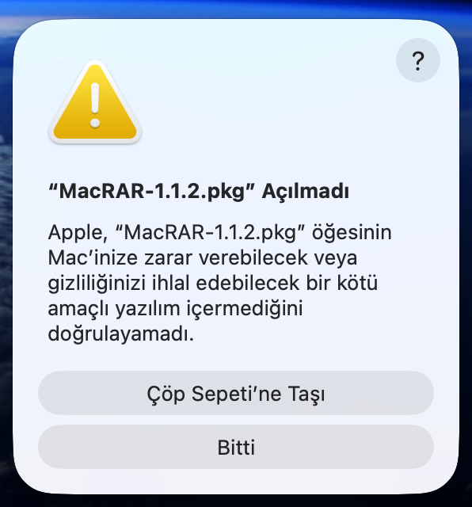
  &nbsp;
  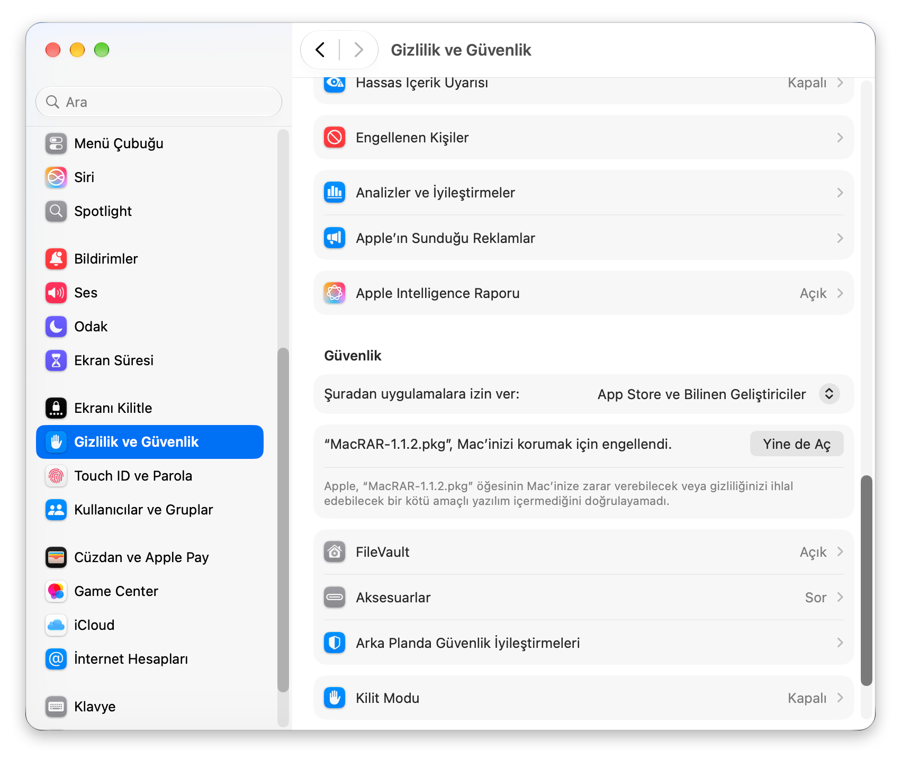
</p>
<p align="center"><sub>Solda: <b>Bitti</b>'ye tıklayın. Sağda: <b>Sistem Ayarları ▸ Gizlilik ve Güvenlik ▸ Yine de Aç</b>.</sub></p>

> MacRAR, RARLAB veya WinRAR ile bağlantılı değildir. Kurulum paketi yalnızca RARLAB'ın ücretsiz **`unrar`** aracını (değiştirilmemiş, lisansıyla birlikte) taşır;
> `rar` paketlenmez, Kurulum Yardımcısı onu isteğiniz üzerine doğrudan rarlab.com'dan indirir.

Sürümler ve değişiklik notları: [GitLab ▸ Sürümler](https://gitlab.com/freeware2/macrar/-/releases).

## Ekran görüntüleri

*Görüntülerde İngilizce arayüz görünüyor; Türkçe seçildiğinde pencereler aynıdır.*

### Ana pencere

Örnek arşivlerle dosya gezgini; eylem çubuğunda Ekle, Çıkar, Sına, Görüntüle, Sil, Bilgi, Onar, Birleştir ve Karşılaştır.

<p align="center">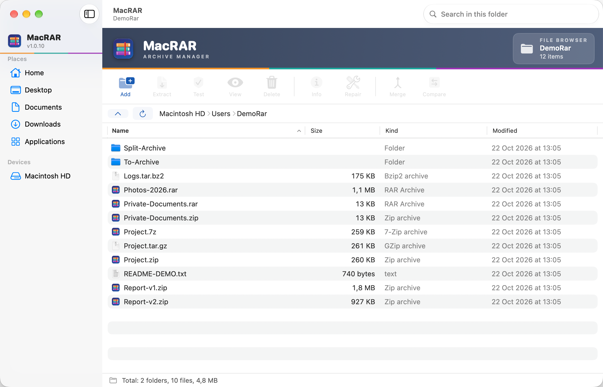</p>

### ⭐ Finder sağ tık menüsü

> **Arşivlerle MacRAR'ı açmadan, doğrudan Finder'dan çalışın.** Herhangi bir dosya, klasör ya da arşive sağ tıklayın; MacRAR girdileri simgesiyle Finder'ın kendi menüsündedir:
>
> - **Arşivlerde:** Aç · Dosyaları Çıkar… · Buraya Çıkar · “arşiv adı/” klasörüne Çıkar
> - **Dosya ve klasörlerde:** Arşive Ekle… · “ad.rar” / “ad.zip” olarak Sıkıştır · Zaman Damgalı RAR'a / ZIP'e Sıkıştır
>
> İşlem arka planda, küçük bir ilerleme paneliyle yürür; girdiler MacRAR'da seçilen dili izler (burada Finder Türkçeyken menü İngilizce).

<p align="center">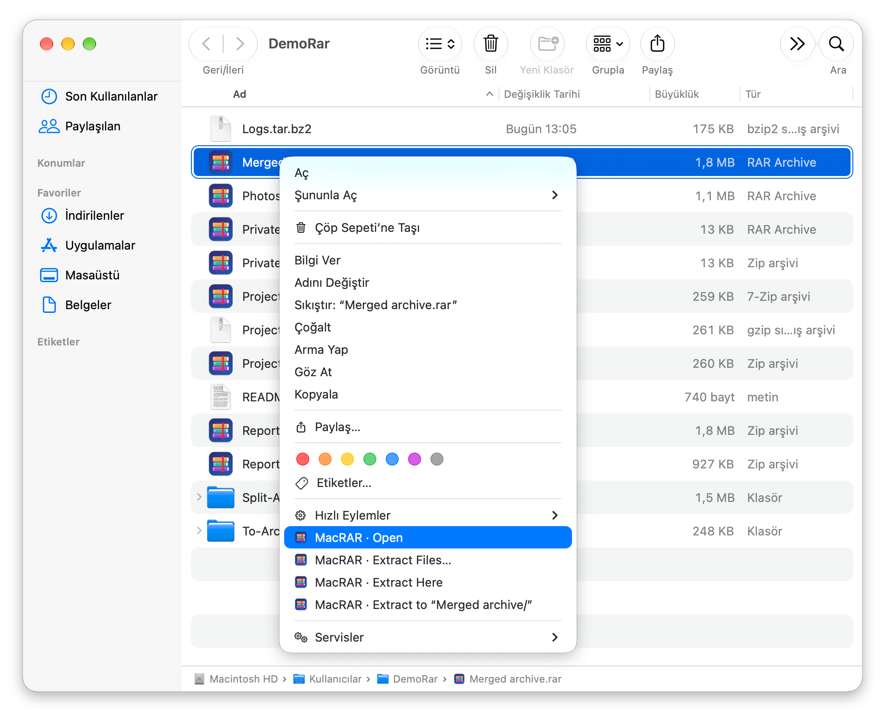</p>

### Arşivleri karşılaştır

Bir raporun iki sürümü: yalnızca bir arşivde olan ve içeriği (CRC) farklı dosyalar listelenir.

<p align="center">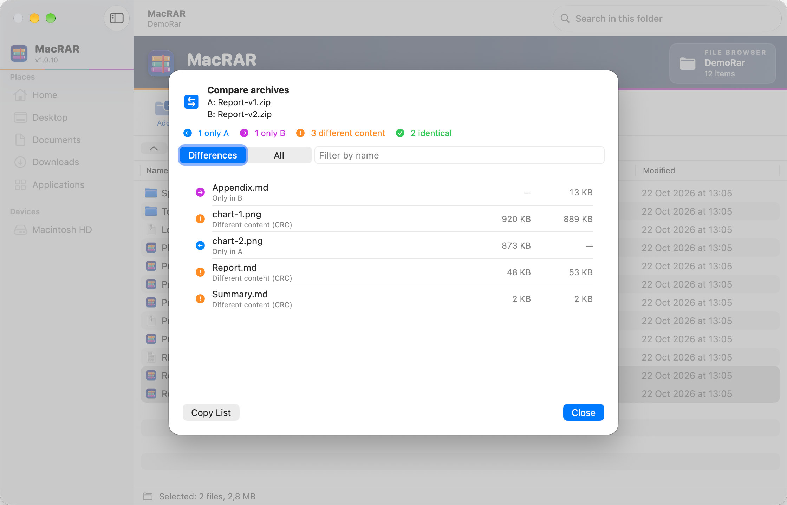</p>

### Parola sorusu

Şifreli arşivlerde açılır; kayıtlı parolalar menüsünü ve parolayı kaydetme seçeneğini içerir.

<p align="center">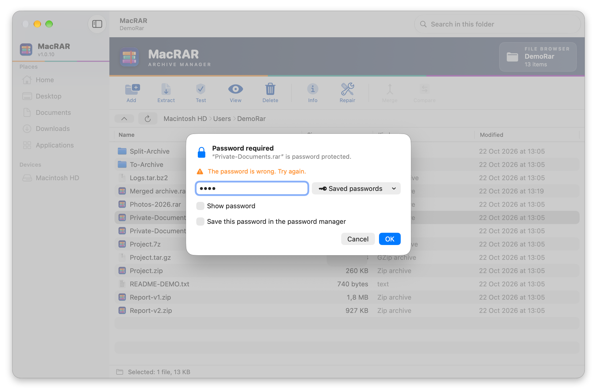</p>

### Parola yöneticisi

Parolalar macOS Anahtar Zinciri'nde saklanır.

<p align="center">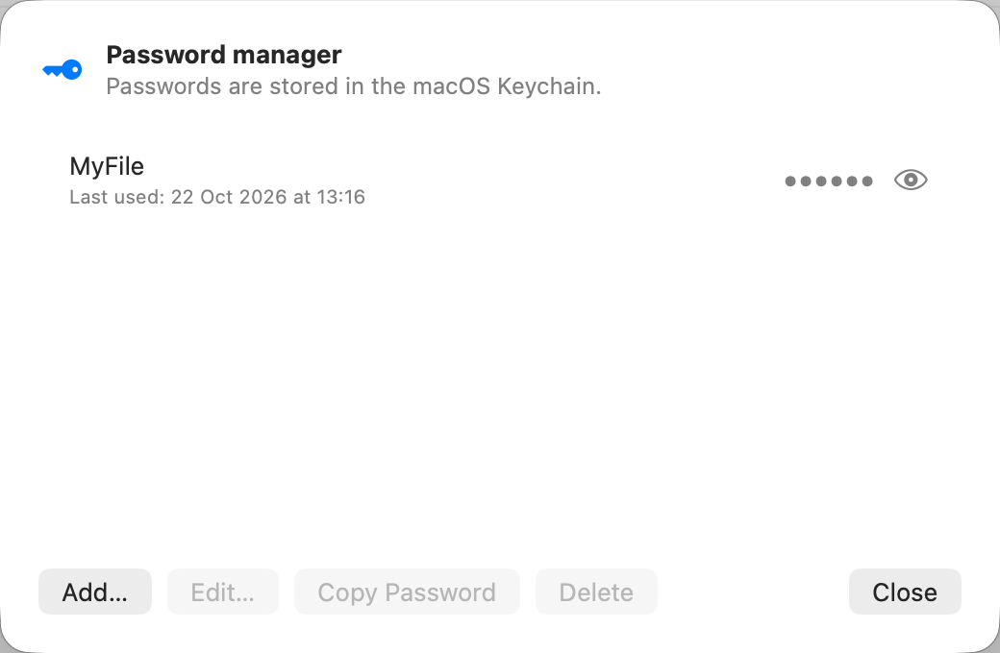</p>

### Ayarlar ▸ Genel

Gizli dosyalar, arayüz dili ve parola yöneticisi.

<p align="center">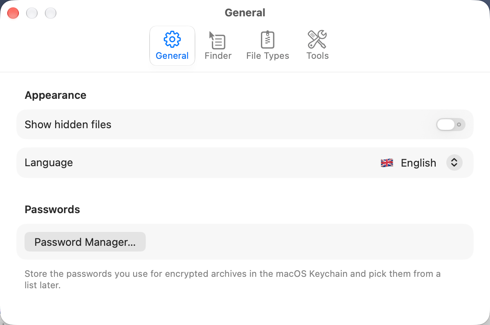</p>

### Ayarlar ▸ Finder

Hızlı sıkıştırmanın zaman damgası biçimi ve sağ tık menüsü anahtarı.

<p align="center">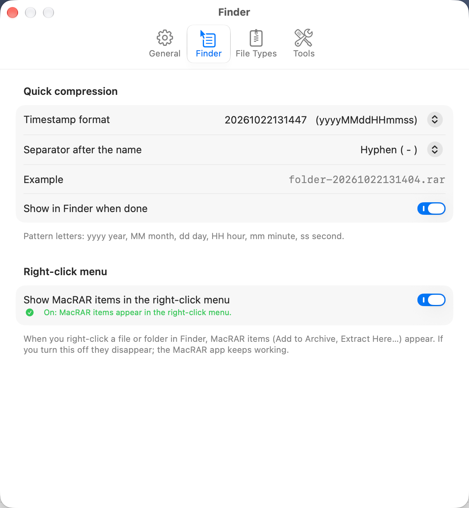</p>

### Ayarlar ▸ Dosya türleri

RAR, 7Z, ZIP ve TAR.GZ için varsayılan uygulama.

<p align="center">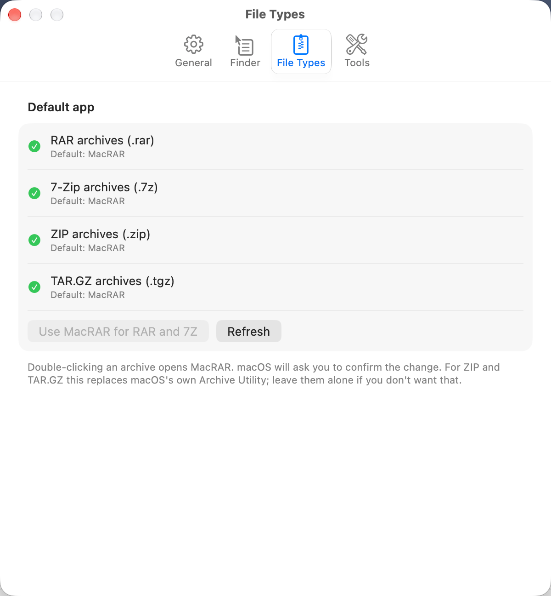</p>

### Kurulum Yardımcısı

RAR araçları, Finder menüsü ve varsayılan uygulama durumunu gösterir, eksikleri tek tıkla düzeltir.

<p align="center">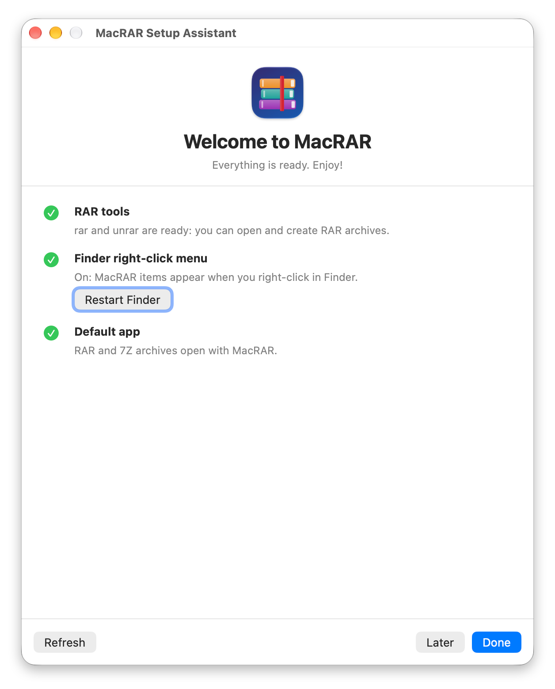</p>

## Özellikler

- **Arşivi açmadan içine bakma:** klasör ağacında gezinme, sıralama, arşiv içinde arama (büyük/küçük harf ve aksan duyarsız),
  boyut / sıkıştırılmış boyut / CRC32 / tarih sütunları.
- **Çıkarma:** tüm arşiv veya seçili dosya/klasörler; üzerine yaz / atla / otomatik yeniden adlandır; yolsuz çıkarma;
  arşiv adıyla alt klasör. Arşivden Finder'a **sürükleyerek** çıkarma (çıkarma bırakma anında yapılır).
- **Sıkıştırma:** RAR5, RAR4, ZIP (AES-256 parolalı), 7Z, TAR.GZ/BZ2/XZ. RAR için yöntem (0–5), sözlük boyutu, katı arşiv,
  parola + dosya adı şifreleme, kurtarma kaydı, parçalara bölme, kilitleme, yorum, sınama, arşivlemeden sonra silme.
  Arşiv adına isteğe bağlı **zaman damgası** (biçimi seçilebilir). **Arşivle** penceresi Genel / Parola / Gelişmiş sekmelerine ayrılmıştır
  (parolayı göster, kayıtlı parolalardan seç). ZIP/7Z/TAR için `rar` gerekmez.
- **Gerçek ilerleme:** sıkıştırma ve çıkarmada bayt bazlı, geri gitmeyen ilerleme çubuğu (büyük tek dosyada da akar).
- **Arşiv düzenleme:** **RAR** için dosya ekleme, silme, yeniden adlandırma, yorum, kurtarma kaydı, kilitleme, onarma. **ZIP** için ekleme
  (alt klasöre de; aynı adlı dosyalar değişir), silme ve yeniden adlandırma; `rar` gerekmez, parolalı (AES-256) ZIP'te açık arşivin parolası kullanılır.
  ZIP, geçici dosyaya yeniden yazılıp atomik olarak yerine konur (hata olursa asıl arşiv bozulmaz); büyük ZIP'te işlem arşivi baştan yazdığı için zaman alabilir.
  7Z/TAR salt okunurdur.
- **Sına:** RAR, ZIP, 7Z ve TAR için; klasör kipinde birden çok arşiv seçilip tek seferde sınanır, sonuç tek özette gösterilir.
- **Arşivleri birleştir:** 2 veya daha fazla arşiv seçilip içerikleri tek yeni arşivde toplanır (aynı yoldaki dosyalarda sonraki arşiv geçerli olur; önceden uyarır).
- **Arşivleri karşılaştır:** iki arşivin içeriği diske çıkarılmadan karşılaştırılır (yalnızca birinde olanlar, CRC/boyut farkı). ZIP'te CRC, merkezî dizinden okunur.
- **Ekle penceresinde tahmini arşiv boyutu** (kaynaklardan örnek alınarak yaklaşık hesaplanır).
- **Parola yöneticisi:** kullandığınız arşiv parolalarını macOS Anahtar Zinciri'nde saklayıp sonra listeden seçin; her kayda ipucu/not eklenebilir.
- **Finder entegrasyonu:** ana sağ tık menüsünde seçime göre değişen, simgeli MacRAR girdileri (RAR ve ZIP ile sıkıştır, aç, çıkar); işlemler
  **ana pencere açılmadan**, küçük bir ilerleme paneliyle yürür; `.rar` / `.7z` dosyalarında MacRAR simgesi.
- **Kurulum Yardımcısı** ve **Ayarlar** (Genel / Finder / Dosya türleri / Araçlar); `rar`'ı tek tıkla RARLAB'dan indirip kurma;
  **Yardım ▸ MacRAR'ı Kaldır…**
- **Hakkında penceresi** (MacRAR menüsü ▸ MacRAR Hakkında): sürüm/derleme, geliştirici, kısa kullanım ve kısayollar, araç sürümleri ile Finder eklentisi durumu.
- **Önizle** (Quick Look / Boşluk), çift tıkla açma, sürükle-bırak (arşivi aç / dosyaları arşivle), bağlam menüleri.
- WinRAR gibi iki kipli pencere: arşiv açık değilken dosya yöneticisi, arşive girince arşiv içeriği. Üst klasör / Backspace ile çıkış.
- **Arşivdeki Mac uygulamaları:** ZIP, RAR ya da 7Z içinde bir `.app` varsa MacRAR bunu tanır; üstteki bilgi çubuğundan **Çıkar** ya da **Uygulamalar'a Kur** seçilebilir, satıra çift tıklamak klasöre girmek yerine aynı seçenekleri sunar. Var olan kopya Çöp Sepeti'ne taşınır, karantina işareti korunur, bozuk imzalı uygulama kurulmaz.
- **Kendini güncelleme:** MacRAR yeni sürümü GitLab'dan denetler, sorar, indirip doğrular ve yerine koyup yeniden açılır; Finder menüsü, kayıtlı parolalar, ayarlar ve `rar` aracı yerinde kalır. Otomatik denetim **Ayarlar ▸ Genel**'den kapatılabilir; elle denetim için **MacRAR ▸ Güncellemeleri Denetle…** ya da Hakkında penceresindeki düğme kullanılır.
- **Türkçe ve İngilizce arayüz:** MacRAR sistem dilini izler; **Ayarlar ▸ Genel ▸ Dil**'den ya da ilk açılışta doğrudan **Kurulum Yardımcısı**'ndan (🌐 Sistem dili / 🇹🇷 Türkçe / 🇬🇧 English) değiştirilebilir. Kurulum Yardımcısı'nda dil anında değişir; Ayarlar'dan yapılan değişiklik MacRAR yeniden açılınca geçerli olur. Finder sağ tık menüsü de seçilen dili kullanır.

## Gereksinimler

- macOS 15 veya üzeri
- **RAR açmak:** RARLAB'ın ücretsiz `unrar` aracı uygulamayla birlikte gelir (RARLAB lisansı madde 3.a: UnRAR bileşenleri ayrı dağıtılabilir;
  dosya ve lisans metinleri `scripts/fetch_unrar.sh` ile resmi paketten, SHA-256 doğrulanarak değiştirilmeden alınır).
  Sisteminizde `unrar`/`rar` kuruluysa o kullanılır.
- **RAR oluşturmak/düzenlemek:** RARLAB'ın `rar` aracı gerekir. RARLAB lisansı deneme sürümünün başka bir yazılımın içinde dağıtılmasını yazılı izin
  olmadan yasaklar, bu yüzden MacRAR onu **paketlemez**. Kurulum Yardımcısı'ndaki **“rar'ı RARLAB'dan indir ve kur”** düğmesi (ana penceredeki uyarı çubuğunda
  **“RAR'ı indir ve kur”**) resmi paketi `https://www.rarlab.com` adresinden indirir, `rar`/`unrar`ı çalıştırarak doğrular ve yönetici parolası istemeden
  `~/Library/Application Support/MacRAR/tools/rar` klasörüne kurar. Elle kurmak isterseniz paketi
  [rarlab.com/download.htm](https://www.rarlab.com/download.htm) adresinden indirip `rar` dosyasını `/usr/local/bin` içine kopyalayın.
  `rar` deneme sürümü en çok 40 gün ücretsizdir, sonrasında RARLAB lisansı gerekir. *Not: Homebrew'daki `rar` paketi (cask) Gatekeeper denetiminden geçmediği için
  1 Eylül 2026'da devre dışı bırakıldı; `brew install --cask rar` artık çalışmaz.*
- **İsteğe bağlı (`unar`):** `unrar`/`rar` hiç yoksa ve `unar` + `lsar` kuruluysa MacRAR RAR arşivlerini bunlarla (salt okunur) açar, listeler, sınar ve çıkarır.
  Sınırlar: klasör yapısı olmadan çıkarma desteklenmez, çakışan üst klasör yeniden adlandırılır (`src` → `src-1`) ve parola `unar`/`bsdtar`
  komut satırında geçici olarak görünür (`rar`/`unrar` kullanıldığında RAR parolaları stdin ile gider).
  ZIP/7Z/TAR oluşturma bunlarsız çalışır.
  Araç yollarını **Ayarlar ▸ Araçlar** sekmesinden değiştirebilirsiniz.
- Derlemek için Xcode komut satırı araçları (Swift 5.10+) ve internet bağlantısı: `scripts/build_app.sh`, ücretsiz `unrar`ı RARLAB'dan (SHA-256 doğrulamalı) `build/cache` içine indirip uygulamaya koyar.

## Kurulum

### Kurulum paketiyle (önerilen)

İndirdiğiniz **`MacRAR-<sürüm>.pkg`** dosyasını açın ve adımları izleyin (yönetici parolası istenir). Kurulum:

1. MacRAR'ı `Uygulamalar` klasörüne kurar,
2. **Finder sağ tık menüsü eklentisini etkinleştirir** ve Finder'ı yeniden başlatır,
3. MacRAR'ı açar; ilk açılışta **Kurulum Yardımcısı** kalan adımları (RAR araçları, varsayılan uygulama) gösterir ve tek tıkla düzeltmenizi sağlar.

Kurulumdan sonra elle yapılacak bir şey kalmaz. Paket Apple onaylı olmadığı için **macOS ilk açılışta onu engeller**: uyarıda **Bitti**'ye tıklayın, sonra
**Sistem Ayarları ▸ Gizlilik ve Güvenlik ▸ Yine de Aç**'a tıklayın (bu sayfanın başındaki ekran görüntülü uyarıya bakın).
Kurulum günlüğü: `/tmp/MacRAR-kurulum.log`. Kaldırmak için: MacRAR içinde **Yardım ▸ MacRAR'ı Kaldır…** (uygulamayı, Finder eklentisini ve kurulum kaydını siler; ayarlar, indirilen araçlar ve kayıtlı parolalar için seçenek sunar) ya da Terminal'de `bash uninstall.sh`.
Uygulamayı yalnızca Çöp Sepeti'ne atarsanız ayarlar, `~/Library/Application Support/MacRAR` ve Anahtar Zinciri'ndeki parolalar geride kalır.

Kurulum, kendini güncelleyebilmesi için uygulamanın sahipliğini kurulumu yapan kullanıcıya verir. 1.1.3 ve öncesi kendini güncelleyemez; 1.2.0 bir kez paketle elle kurulur. Sıkıştırma ya da çıkarma sürerken güncelleme başlamaz. Uygulamaya yazma izniniz yoksa (ör. başka bir kullanıcının kurduğu kopya) MacRAR indirme sayfasını önerir.

**Kurulum Yardımcısı**, MacRAR'ın ilk açılışında kendiliğinden açılır; sonradan **Yardım ▸ Kurulum Yardımcısı…** ile açılır.
RAR araçları (`rar`/`unrar`), Finder menüsü ve varsayılan uygulama durumunu gösterir, eksikleri düzeltme düğmeleri sunar
(`rar` için “rar'ı RARLAB'dan indir ve kur”).

Paketi kendiniz üretmek için:

```bash
scripts/build_pkg.sh     # build/MacRAR-<sürüm>.pkg + .sha256 + KURULUM.txt + INSTALL.txt + uninstall.sh + LICENSE.txt
PKG_SIGN_IDENTITY="Developer ID Installer: …" scripts/build_pkg.sh   # (isteğe bağlı) imzalı paket
```

### Kaynaktan (geliştirme)

```bash
git clone https://gitlab.com/freeware2/macrar.git && cd macrar
UNIVERSAL=1 INSTALL=1 scripts/build_app.sh   # /Applications/MacRAR.app'e kurar (UNIVERSAL: arm64 + x86_64)
pluginkit -e use -i local.macrar.app.FinderSync && killall Finder   # Finder sağ tık menüsünü etkinleştirir
```

`INSTALL=1` olmadan betik yalnızca `build/MacRAR.app` üretir. Her yeniden kurulumdan sonra `killall Finder` çalıştırın
(Finder eski eklenti bağlantısını tutar; yapılmazsa sağ tık menüsü kaybolur).

Eklentiyi arayüzden de açabilirsiniz: Sistem Ayarları ▸ Genel ▸ Oturum Açma Öğeleri ve Eklentiler ▸ Eklentiler ▸ **Finder** ▸ MacRAR.

### İmzalama ve Anahtar Zinciri izni

Varsayılan **ad-hoc imzada** kod özeti her derlemede değişir; bu yüzden her güncellemeden sonra macOS, parola yöneticisi için
Anahtar Zinciri iznini yeniden sorar. Bunu önlemek için gerçek bir imzalama kimliğiyle derleyin
(`security find-identity -p codesigning` ile adını görün):

```bash
SIGN_IDENTITY="Apple Development: Ad Soyad (TAKIMID)" UNIVERSAL=1 INSTALL=1 scripts/build_app.sh
```

Kimlik sabit kaldığı için "Her Zaman İzin Ver" bir kez verildiğinde sonraki güncellemelerde de geçerli olur.
Yerelde derlenen uygulama karantinaya alınmadığı için genellikle Gatekeeper uyarısı çıkmaz; çıkarsa
**Sistem Ayarları ▸ Gizlilik ve Güvenlik ▸ Yine de Aç**'a tıklayın (macOS 15'te sağ tık ▸ Aç yolu yoktur).

## Finder'da kullanım

### Ana sağ tık menüsü (Finder Sync eklentisi)

Eklenti etkinleştirilince MacRAR girdileri (simgesiyle) doğrudan sağ tık menüsüne gelir ve seçime göre değişir:

- **Arşiv dosyası** seçiliyse: `MacRAR · Aç`, `Dosyaları Çıkar…`, `Buraya Çıkar`, `“arşiv adı/” klasörüne Çıkar`
- **Dosya/klasör** seçiliyse: `Arşive Ekle…` (parola vb. tüm seçeneklerle), `“ad.rar” olarak Sıkıştır`, `Zaman Damgalı RAR'a Sıkıştır`
  ve macOS'un yerleşik `bsdtar`'ı ile `“ad.zip” olarak Sıkıştır`, `Zaman Damgalı ZIP'e Sıkıştır` (ZIP için `rar` gerekmez).
  **`rar` kurulu değilse RAR sıkıştırma girdileri menüde görünmez**; uygulama `rar` durumunu (ve seçilen arayüz dilini) `~/Library/Application Support/MacRAR/finder.state`
  dosyasına yazar, korumalı çalışan Finder eklentisi menüyü kurarken onu okur. `rar` kurulunca menü bir sonraki sağ tıkta kendiliğinden güncellenir.

Hızlı çıkarma var olan dosyaların üzerine **yazmaz**: RAR'da çakışan dosya otomatik yeniden adlandırılır (`dosya(1).txt`),
ZIP/7Z/TAR'da atlanır. Birden çok arşiv seçilirse her biri kendi klasörüne çıkarılır.

**Pencere davranışı:** Finder'dan başlatılan sıkıştırma/çıkarma işlemlerinde **ana pencere açılmaz**; yarım saniyeden uzun süren işlemler için
küçük, marka bantlı bir **ilerleme paneli** gösterilir (X ile kapatmak işlemi iptal eder). **Arşive Ekle…** ve **Dosyaları Çıkar…**
pencereleri de ana pencere olmadan, taşınabilir bağımsız bir pencerede (üstünde MacRAR bandıyla) açılır. Ana pencere yalnızca parola sorusu,
hata ya da `MacRAR · Aç` için açılır. Servisler/Hızlı Eylemler altında ayrı MacRAR girdileri yoktur; her şey Finder'ın ana sağ tık
menüsündedir.
MacRAR'ı Finder'daki bir işlem **başlattıysa**, iş bitince MacRAR kendiliğinden kapanır; zaten açıksa ve siz kullanıyorsanız açık kalır.
`MacRAR · Aç` pencereyi açık bırakır.

### Zaman damgalı adlar

**Ayarlar ▸ Finder** sekmesinden hazır bir biçim (`20261009112345`, `2026-10-09_11-23-45`, …) veya özel desen (`yyyy-MM-dd_HH-mm-ss`) ile ayırıcı
(`-`, `_`, boşluk, yok) seçilir; ayarlarda canlı örnek ad görünür. Aynı işlem uygulamada Komutlar menüsünde (⌥⌘Z / ⇧⌥⌘Z)
ve Ekle penceresindeki "Ada zaman damgası ekle" seçeneğinde de vardır.

### Dosya ilişkileri ve simge

MacRAR, `.rar` ve `.7z` türlerini kendi simgesiyle tanımlar; Finder'da bu dosyalar MacRAR simgesiyle görünür.
**Varsayılan uygulama:** **Ayarlar ▸ Dosya türleri** sekmesinde RAR, 7Z, ZIP ve TAR.GZ için şu anki varsayılan uygulama görünür;
"MacRAR'ı varsayılan yap" düğmesine basıp macOS'un sorusunu onayladığınızda bu dosyalar çift tıklayınca MacRAR'da açılır. Düğmeler yalnızca MacRAR `Uygulamalar` klasöründe
kuruluyken etkindir. (Başka bir yol: bir arşive sağ tıklayın ▸ Bilgi Ver ▸ Birlikte aç ▸ MacRAR ▸ Tümünü Değiştir.)
Simge önbellekte kalırsa `killall Finder` (gerekirse `killall Dock`) çalıştırın.

## Ayarlar

| Sekme | İçerik |
|---|---|
| **Genel** | Gizli dosyaları göster, **Dil** (Sistem dili / Türkçe / English), Parola Yöneticisi |
| **Finder** | Hızlı sıkıştırmanın zaman damgası biçimi/ayırıcısı, “bitince Finder'da göster” ve **sağ tık menüsünü aç/kapat** anahtarı (değişiklik için Finder'ın yeniden başlaması gerekir; düğme sunulur) |
| **Dosya türleri** | RAR, 7Z, ZIP, TAR.GZ için varsayılan uygulama |
| **Araçlar** | `rar` / `unrar` / `bsdtar` yolları ve `rar` kurulumu |

## Parola yöneticisi

Şifreli bir arşiv açarken (veya Arşivle penceresinin **Parola** sekmesinde) **Kayıtlı parolalar** menüsünden daha önce kullandığınız bir parolayı seçebilir,
**“Bu parolayı parola yöneticisine kaydet”** ile yenisini ekleyebilirsiniz. Her kayda isteğe bağlı bir **ipucu/not** yazılabilir (parolanın kendisini değil); ipucu kayıtlı parola menülerinde adın yanında görünür. Parola, arşivi gerçekten açtıktan sonra kaydedilir
(yanlış parola kaydedilmez; aynı parola iki kez eklenmez; kayıt sonucu bildirimle gösterilir). Yönetim: **Komutlar ▸ Parola Yöneticisi…**
(⇧⌘P) veya Ayarlar ▸ Genel; ekle / düzenle / sil / göster / kopyala (kopyalanan parola panodan 30 sn sonra silinir).

Parolalar macOS **Anahtar Zinciri**'nde tek bir öğe olarak saklanır; uygulama Anahtar Zinciri'ne yalnızca parola gerektiğinde dokunur.

## Mimari

| Parça | Görev |
|---|---|
| `Sources/MacRARCore` | Arayüzden bağımsız çekirdek: `ProcessRunner` (alt süreç, iptal, stdin), `RarListParser` / `TarListParser` / `UnarListParser` (liste çıktısı), `ProgressParser` / `ProgressTracker` (ilerleme), `TransferMonitor` (açık dosya konumundan bayt bazlı ilerleme), `ArchiveService` (tüm işlemler), `ZipEditing` (ZIP ekleme/silme/yeniden adlandırma, merkezî dizin okuyucu), `ArchiveComparison` (karşılaştırma ve birleştirme çakışmaları), `SizeEstimator` (tahmini arşiv boyutu), `RARInstaller` (rar'ı RARLAB'dan indirip kurma), `ToolPaths` / `ToolGuidance` (araç bulma ve yönergeler), `AppRemoval` (uygulama içi kaldırma), `UpdateInfo` / `Updater` (GitLab'dan kendini güncelleme), `ArchivedApps` / `AppInstaller` (arşivdeki uygulamayı tanıma ve kurma), `PasswordVault` (Anahtar Zinciri), `ArchiveNaming` (ad ve zaman damgası), `FinderIntegration` / `FinderToken` / `FinderState` (menü içeriği, eklenti↔uygulama komutları, gizli anahtar, `rar` durumu ve dil). |
| `Sources/MacRAR` | SwiftUI uygulaması: `AppModel` (durum + işlem akışı), `MainView`, `FileTableView`, `AddSheet` / `OtherSheets` (Ekle/Çıkar), `CompareSheet` (arşiv karşılaştırma), `ProgressPanel` / `SheetPanel` (Finder'dan başlatılan işlemlerin ilerleme paneli ve taşınabilir diyalog penceresi), `SettingsView`, `AppLanguage` (dil seçimi), `SetupAssistant`, `AppRemovalView`, `UpdateController` (güncelleme akışı ve penceresi), `ArchivedAppFlow` (arşivdeki uygulama için çubuk ve kurma akışı), `ArchiveDrag`. |
| `FinderExtension` | Finder Sync eklentisi (`MacRARFinder.appex`); `build_app.sh` tarafından derlenip uygulamaya gömülür. Ortak kaynaklar: `FinderIntegration`, `FinderToken`, `FinderState`. |
| `Resources` | Arayüz çevirileri: `tr.lproj` ve `en.lproj` (`Localizable.strings`, çoğullar için `Localizable.stringsdict`, `InfoPlist.strings`); `FinderExtension/` eklentinin kendi adı. Anahtarlar kaynak koddaki Türkçe metinlerin kendisidir. |
| `scripts` | `build_app.sh` (paketleme, imzalama, kurulum), `make_release.sh` (sürüm dosyaları, denetimler ve yayım), `fetch_unrar.sh` (resmi paketten `unrar`ı doğrulayarak alır), `build_pkg.sh` (kurulum paketi: `pkg/` altında betikler, iki dilli sayfalar, dağıtım tanımı), `check_strings.sh` (eksik çeviri denetimi), `uninstall.sh`, `Info.plist` dosyaları, simge üreteci. |

Eklenti korumalı (sandbox) çalıştığından dosyalara dokunmaz; seçilen yolları `macrar://` bağlantısıyla uygulamaya iletir.
Bağlantılar, **o kuruluma özgü gizli bir anahtar** içermiyorsa reddedilir: anahtar her kurulumda (kullanıcı hesabında) ilk açılışta
rastgele üretilir ve `~/Library/Application Support/MacRAR/finder.token` dosyasında yalnızca sahibin okuyabileceği izinle (0600) durur.
Hiçbir sürümde ortak/sabit anahtar yoktur; bir web sayfası dosyayı okuyamadığı için uygulamayı bu şemayla tetikleyemez.
Eklenti yalnızca bu klasörü **salt okunur** görebilen bir yetkiyle çalışır (yazamaz). Anahtar güncellemelerde korunur;
dosyayı silerseniz uygulama bir sonraki açılışta yenisini üretir.

Araçlarla ilgili öğrenilenler:

- CLI her zaman `LC_ALL=en_US.UTF-8` ile çalıştırılır; aksi hâlde GUI uygulamasında Türkçe dosya adları bozulur.
- RAR parolaları komut satırına değil **stdin**'e yazılır (`-p` değersiz), böylece `ps` çıktısında görünmez. İstisnalar: ZIP için `bsdtar --passphrase` ve `unar -p`.
  Foundation `Process`, ASCII dışı argümanları NFD'ye çevirir (`ş` → `s` + çengel) ve parolayı bozar; bu yüzden bu parolalar `/bin/sh` + `printf`
  ile baytı baytına iletilir.
- `rar`, arşivi değiştirirken geçici `__rar_….rartemp` dosyasını **çalışma klasöründe** açar. Finder/Dock'tan açılan uygulamanın çalışma klasörü `/`
  (salt okunur) olduğundan düzenleme işlemleri arşivin kendi klasöründe çalıştırılır.
- `bsdtar` dosya adını dosya **bittikten sonra** yazdırır; ilerleme, aracın açık dosyasının konumu `libproc` ile okunarak bayt bazında hesaplanır
  (yollar `realpath` ile çözülür; Foundation `/var` → `/private/var` ön ekini atladığı için kullanılmaz). `rar` sıkıştırılamayan veride yüzdeyi iki kez
  başlatabilir; çubuk bu yüzden geri gitmeyecek şekilde tutulur.
- Arşivler uzantıya değil içerik imzasına (`Rar!`) bakılarak tanınır.
- İndirilmiş (karantinalı) arşivden çıkan dosyalar `com.apple.quarantine` özniteliğini devralır; Gatekeeper denetimi atlanmaz.
- `rar` macOS sürümü ZIP üretemez; ZIP/7Z/TAR için `bsdtar` kullanılır. 7Z/TAR'da düzenleme yoktur.
- **ZIP düzenleme** (`ZipEditing.swift`): ZIP'te yerinde düzenleme aracı olmadığından arşiv `bsdtar` ile geçici dosyaya yeniden yazılır, bitince `replaceItemAt` ile
  yerine konur. Parolasızda eski girdiler `bsdtar -c … @eski.zip` ile akıtılarak kopyalanır: silinenler `-X` (tam eşleşen, kaçırılmış desen), yeniden adlandırma
  `-s` ile yapılır. Yeni dosyalar `macrar-new/` altında sembolik bağlantı olarak hazırlanıp `-H` ile izlenir ve `-s` ile hedef klasöre çevrilir; böylece `-X`
  yalnızca ESKİ girdilerdeki aynı adlı kayıtları eler (yenisi eskisinin yerini alır). bsdtar 3.5.3'te `-s` yerine metninde `&` düz karakterdir ve `\` bozulur
  (bu yüzden `\` içeren adlar reddedilir); bağlantı hedeflerine dokunmamak için `S` bayrağı kullanılır.
- **Parolalı (AES-256) ZIP:** bsdtar `--passphrase` ile aynı çağrıda hem `@arşiv` okuyup hem şifreli yazamaz (kütüphane hatası), bu yüzden arşiv geçici klasöre
  açılır, değişiklik uygulanır ve aynı parolayla yeniden paketlenir. AES ZIP'te dosya **adları şifresiz** olduğundan arşiv parolasız listelenir; bu yüzden
  düzenleme öncesi parola gerekiyorsa sorulur (aksi halde bsdtar sonsuza dek "Enter passphrase" yazar).
- **ZIP ayrıntıları** (CRC32, sıkıştırılmış boyut, yöntem, şifreli): `unzip -v` macOS'ta oluşan ayrışık (NFD) Unicode adları bozduğundan merkezî dizin
  doğrudan okunur (zip64 dahil). AES-2 (AE-2) girdilerinde CRC alanı 0'dır; bilinmiyor sayılır.
- **Karşılaştırma ve birleştirme:** karşılaştırma yalnızca girdi listelerine (CRC/boyut) bakar, diske çıkarmaz. Birleştirme arşivleri geçici klasöre
  sırayla açıp normal Ekle penceresini yeni arşiv için açar (son arşiv kazanır); geçici klasör ekleme bitince silinir.

## Geliştirme

```bash
swift build          # derle
swift run MacRAR     # çalıştır (paketsiz; Finder entegrasyonu için scripts/build_app.sh gerekir)
swift test           # testler gerçek rar/bsdtar ile çalışır; yoksa ilgili testler atlanır
```

Ortam değişkenleri: `MACRAR_TEST_RAR_DIR=<klasör>` (rar/unrar'ı o klasörden kullan, örn. resmi sürümle sına), `MACRAR_TEST_UNAR_DIR=<klasör>` (`unar`/`lsar`),
`MACRAR_TEST_ONLY_UNAR=1` (RAR için yalnızca `unar`), `MACRAR_TEST_LIVE=1` (rarlab.com'dan gerçek indirme testi, ağ gerekir),
`MACRAR_TEST_BIG=1` (1,5 GB'lık çıkarma ilerleme testi).

### Çeviriler

Kaynak koddaki Türkçe metinler (`Text("…")`, `Button("…")`, `String(localized: "…")`) aynı zamanda çeviri anahtarıdır; İngilizceleri
`Resources/en.lproj` içindedir. Yeni bir metin ekledikten sonra eksik çeviri olup olmadığını denetleyin:

```bash
scripts/check_strings.sh   # her iki dilde eksik metinleri listeler; eksik yoksa 0 ile çıkar
```

## Bilinen sınırlar

- Sürükleyerek çıkarmada parola gerekiyorsa ilk deneme başarısız olur; parola sorulur ve hatırlanır, sürüklemeyi tekrarlayın.
- 7Z ve TAR arşivleri salt okunurdur: içlerine dosya eklenemez, silinemez ya da yeniden adlandırılamaz (RAR ve ZIP düzenlenebilir).
- Adında `*` veya `?` geçen dosyalar RAR komutlarında joker karakter olarak yorumlanabilir (rar'ın sınırlaması).
- Soğuk açılışta ana pencere, açılış nedeni (Finder komutu mu, kullanıcı mı) anlaşılsın diye ilk yaklaşık 1 saniye gizli tutulur.
- Finder'dan gelen **parola** soruları şimdilik ana pencerede çıkar (Ekle/Çıkar pencereleri bağımsızdır).
- `rar` sıkıştırılamayan verilerde (zip, video, rastgele) ikinci bir hızlı geçiş yapar; çubukta kısa bir hızlanma görülebilir.
- Uygulama imzası ad-hoc olduğundan güncelleme denetimi yalnızca paketin bozulmadığını gösterir, yayıncıyı doğrulamaz; güven GitLab hesabına ve HTTPS'e dayanır. Her güncellemeden sonra macOS parola yöneticisi için Anahtar Zinciri iznini yeniden sorabilir.
- Finder menüsündeki `“ad.rar” olarak Sıkıştır` yazısı, eklenti dosya sistemine bakamadığı için adında nokta olan klasörlerde yanıltıcı olabilir (işlem doğru çalışır).

## Sık sorulan sorular

### MacRAR ücretsiz mi?

Evet. MacRAR, GPL-3.0 lisansıyla ücretsiz ve açık kaynaktır; RAR dosyalarını açmak ve çıkarmak da ücretsizdir, çünkü RARLAB'ın ücretsiz `unrar` aracı uygulamayla gelir. Yalnızca **RAR** arşivi oluşturmak ya da düzenlemek için RARLAB'ın `rar` aracı gerekir; 40 gün ücretsiz denenebilir, sonrasında RARLAB lisansı ister. ZIP, 7Z ve TAR oluşturmak için hiç gerekmez.

### Mac'te RAR dosyası nasıl açılır?

MacRAR'ı kurun ve içine bakmak için `.rar` dosyasına çift tıklayın ya da Finder'da sağ tıklayıp ana pencereyi açmadan çıkarın. Parolalı arşivler parolayı sorar.

### Mac'te RAR dosyası oluşturabilir miyim?

Evet. MacRAR'ın Kurulum Yardımcısı RARLAB'ın `rar` aracını rarlab.com'dan tek tıkla indirir; ardından parolalı, dosya adları şifreli, kurtarma kayıtlı ya da parçalara bölünmüş RAR5 veya RAR4 arşivleri oluşturabilirsiniz.

### Finder'ın sağ tık menüsünden sıkıştırıp çıkarabilir miyim?

Evet. Finder'da dosyalara sağ tıklayıp RAR ya da ZIP olarak sıkıştırabilir, bir arşive sağ tıklayıp çıkarabilir ya da açabilirsiniz. İşlem, MacRAR'ın ana penceresi açılmadan küçük bir ilerleme paneliyle yapılır.

### Hangi Mac'lerde çalışır?

macOS 15 Sequoia veya üstü yüklü Apple Silicon ve Intel Mac'lerde.

### MacRAR internete bağlanır mı?

Yalnızca gerektiğinde: günde en çok bir kez GitLab'a son sürüm sorulur (kapatılabilir; bu Mac hakkında bilgi gönderilmez), güncelleme gitlab.com'dan indirilir ve `rar` kurulumu istenirse rarlab.com kullanılır.

### macOS neden ilk seferde engelliyor?

MacRAR, ücretli geliştirici hesabı gerektiren Apple onayından (notarization) geçmemiştir. **Sistem Ayarları ▸ Gizlilik ve Güvenlik ▸ Yine de Aç** ile bir kez izin verin; ayrıntılar [Kurulum](#kurulum) bölümünde.

<sub>WinRAR, Keka, BetterZip ve The Unarchiver yalnızca karşılaştırma için anılmıştır; MacRAR'ın bunlarla ya da RARLAB ile bir bağı yoktur.</sub>

## Lisans

Telif hakkı © 2026 Rafet SAPANCI

MacRAR özgür yazılımdır: [GNU Genel Kamu Lisansı sürüm 3](LICENSE) (GPL-3.0-only) koşullarına göre kullanabilir, değiştirebilir ve yeniden dağıtabilirsiniz.
Değiştirilmiş sürümleri dağıtırsanız kaynak kodlarını da aynı lisansla sunmanız gerekir. Program **hiçbir garanti olmaksızın** sunulur; ayrıntılar için [LICENSE](LICENSE).

Uygulamayla birlikte gelen **`unrar`** RARLAB'ın ayrı bir programıdır ve GPL kapsamında değildir: RARLAB'ın kendi lisansıyla
(değiştirilmeden, `license.txt` ve `acknow.txt` dosyalarıyla birlikte `MacRAR.app/Contents/Resources/unrar/` altında) dağıtılır.
`rar` MacRAR ile gelmez; ücretli bir RARLAB ürünüdür. MacRAR, RARLAB veya WinRAR ile bağlantılı değildir.
